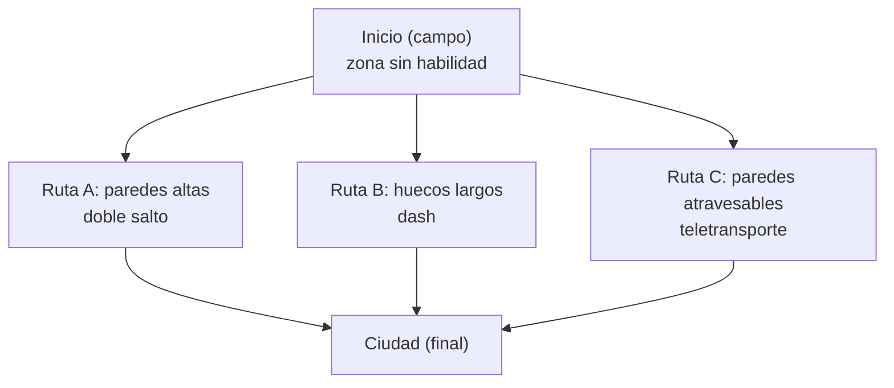

# Memory Select

## 1. Título provisional
**Memory Select**

## 2. El concepto
Un robot recoge tarjetas de memoria que dan habilidades útiles para recorrer el mundo en las siguientes runs. Al principio de cada partida escoges una de las tarjetas que has recogido.

En la primera partida, tienes la zona inicial sin poder salir debido a que no tienes habilidad, al llegar al final de la zona, salta una "cinematica" en el que la camara vuela hasta donde está la zona final y te da la tarjeta de salto doble sacándote al menu de selección de tarjeta (con las otras 2 bloqueadas).

La tarjeta de dash está escondida al final de la ruta del doble salto, y la de teletransporte al final de la ruta del dash. Así, cada tarjeta te lleva a la siguiente.

Al recoger una tarjeta, Solo se guarda que la has recogido y sigues el nivel con normalidad

## 3. El giro
En cada run escoges una tarjeta de memoria (habilidad) que decide si tienes doble salto, dash, etc.

## 4. Controles

| Acción              | Teclado y ratón | Mando (PlayStation) |
|---------------------|-----------------|---------------------|
| Moverse             | WASD            | Joystick izquierdo  |
| Mover la cámara     | Ratón           | Joystick derecho    |
| Saltar              | Espacio         | X                   |
| Usar la habilidad*  | Shift           | Cuadrado            |

\* Si la tarjeta elegida tiene una habilidad que se activa.

## 5. Las tarjetas
- **Doble salto**
- **Dash**: recorre más distancia que el teletransporte, para que el teletransporte no sea un dash mejorado.
- **Teletransporte**: te mueve a una distancia fija.
  - Al pulsar el botón de la habilidad aparece un "fantasma" del jugador en el punto al que se teletransportaría. Al volver a pulsarlo, te teletransportas a ese punto.
  - El fantasma te sigue mientras te mueves y siempre está en la dirección a la que mira el jugador.
  - Si en el destino hay una pared del mundo, el fantasma choca contra ella. Si es una pared pensada para atravesarla con el teletransporte, se ignora.

## 6. El nivel
Empieza en un campo y termina en una ciudad, donde el robot recupera su energía robando electricidad.

## 7. Ganar y perder
- **Ganar:** llegar a la ciudad.
- **Perder:** caerte. Vuelves al inicio del nivel.

## 8. Cámara
La cámara sigue al robot, y el jugador la mueve con el ratón o con el joystick derecho. El robot se mueve en función de hacia dónde mira la cámara.

## 9. Duración
Un juego muy corto con un nivel pequeño: un minijuego de unos 3–5 minutos.

## 10. Lo que NO va a tener
- Enemigos
- Más niveles
- Combate
- Cambiar de tarjeta a mitad de partida
- diálogos y cinemáticas largas

## 11. Lo que SÍ va a tener
- Guardado de las tarjetas de memoria: cuántas has recogido y con cuáles has completado el nivel.

## 12. Arte
Uso los packs de Kenney:
- [Platformer Kit](https://kenney.nl/assets/platformer-kit)
- [City Kit (Industrial)](https://kenney.nl/assets/city-kit-industrial)
- Robot: [Mini Characters](https://kenney.nl/assets/mini-characters)

Tarjetas de memoria: modelo propio hecho en Blender (un modelo, un color e icono distinto por habilidad).
